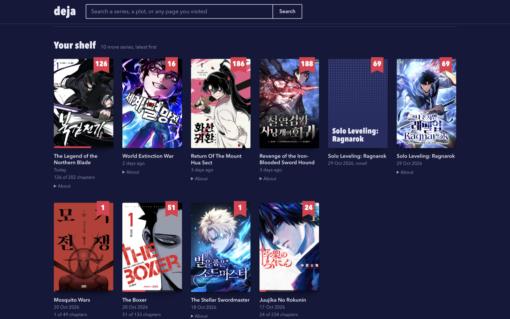

# deja

A personal search engine over your own browser history, running entirely on your Mac. Its first job: *which manhwa was I reading, and where did I stop?*



Chrome deletes history after about 90 days. deja copies it into its own permanent archive, works out which series you have been reading and the last chapter you reached in each, and lets you search all of it from the terminal or a local web page.

## Getting started

Needs macOS, Google Chrome and the system Python 3 (`/usr/bin/python3`). There is nothing to install.

```sh
git clone https://github.com/lakshay007/deja.git
cd deja
bin/deja sync      # archive your Chrome history
bin/deja manhwa    # what am I reading, and where did I stop?
```

To run `deja` from any folder: `ln -s "$PWD/bin/deja" ~/.local/bin/deja`

## Commands

| Command | What it does |
|---|---|
| `deja sync` | Archive new Chrome history and rebuild the series list. |
| `deja manhwa` | Every series, most recently read first, with the last chapter and a link to continue. |
| `deja manhwa <words>` | Find a series by name, or by plot once `deja enrich` has run: `deja manhwa the one with the necromancer`. |
| `deja manhwa --in september` | Only what you read in a period: `2026`, `2026-09`, `2026-09-14` or a month name. |
| `deja manhwa --unsorted` | Chapter pages that could not be matched to a series. |
| `deja search <words>` | Full-text search across everything you have visited. |
| `deja enrich` | Look up new series on AniList for synopsis, genres and cover. |
| `deja web` | The cover grid and search page, at `http://127.0.0.1:8765`. |
| `deja autosync on` | Run `deja sync` at login and daily. Also `off` and `status`. |

## How it decides

- A page is a chapter when its title says "Chapter 12" or "Ch. 12" and the number is also in its address. Pages that are clearly chapters but cannot be named go to `--unsorted`; deja never guesses.
- One series read on several sites, or under several translated names, becomes one entry.
- "Where you stopped" is the highest chapter you opened, so rereading an early chapter does not move your place.
- Plot search matches words, not meaning: "necromancer" finds a series tagged "Necromancy", but "raises the dead" does not.

## Privacy

- Your history stays on your Mac, in `data/`, which is git-ignored.
- Only `deja enrich` uses the network, and only when you run it. It sends series titles to [AniList](https://anilist.co) and downloads the covers; no addresses, dates or chapters.
- The web page is served on `127.0.0.1` only and loads nothing from the network.
- Deleting a page from Chrome does not remove it from deja's archive.

## Limits

- macOS and Chrome only.
- Novels are listed with a "novel" tag and kept apart from the comic of the same name. Anime episodes are ignored.
- `deja autosync` cannot run while the project sits in a folder macOS protects from background jobs, such as Desktop. Keep the clone somewhere like `~/deja` for daily sync, or run `deja sync` by hand every few weeks.
